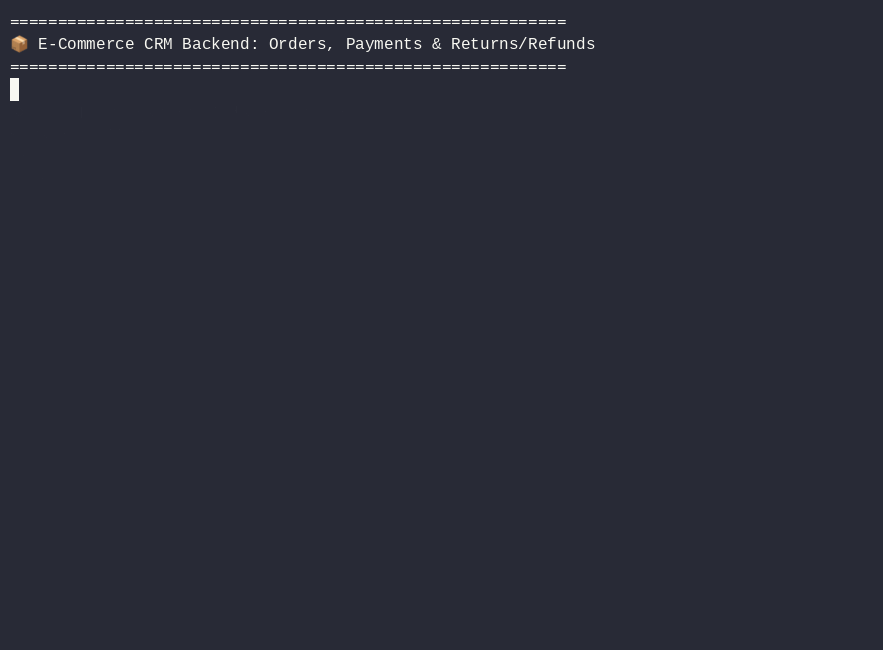
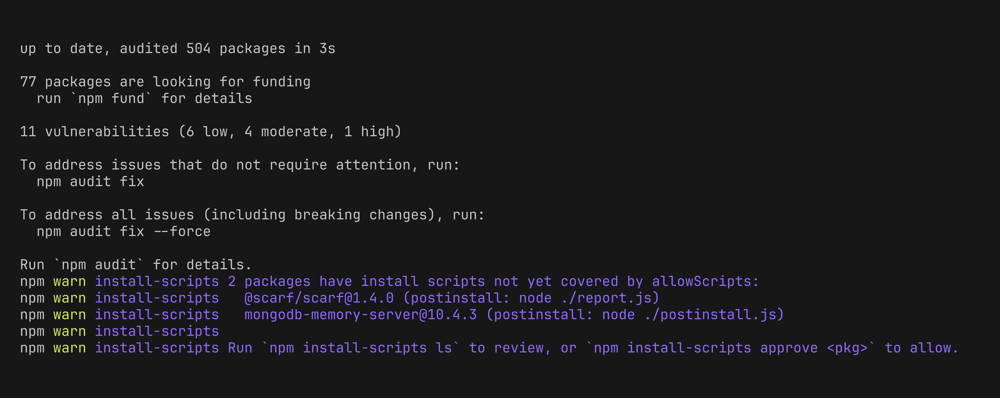
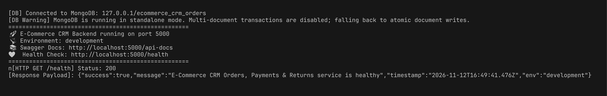
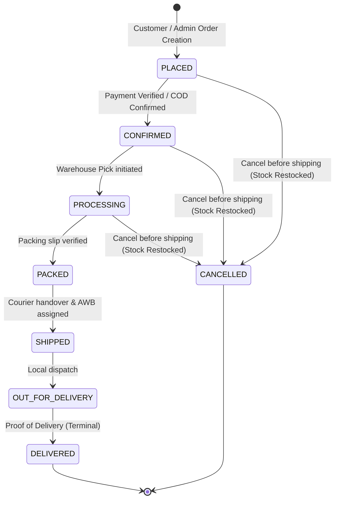
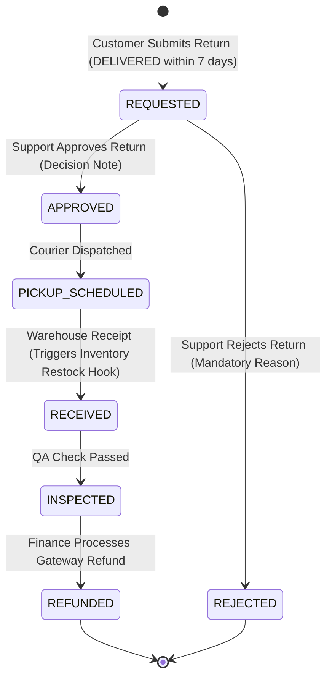

# E-Commerce CRM — Orders, Payments & Returns/Refunds Backend

[](https://nodejs.org/)
[](https://expressjs.com/)
[](https://mongoosejs.com/)
[](https://razorpay.com/)
[](https://jestjs.io/)
[](#)

Production-ready, highly hardened Node.js and Express.js modular monolith backend managing the complete **Orders, Payments, and Returns/Refunds** lifecycle for an enterprise MERN E-Commerce CRM.

---

## 🎬 Terminal Demo



---

## 📸 Proof of Functionality & Test Verification

### 1. Dependency Installation


### 2. Server Boot & Health Probe


### 3. Comprehensive Test Suite (47/47 Tests Passing)


---

## 🚀 Key Architectural Highlights

1. **Strict Integer-Paise Arithmetic**: Floating-point mathematics is strictly prohibited for money. All amounts (subtotals, discounts, taxes, grand totals, payments, and refunds) are represented as non-negative **integer paise** (e.g. ₹799.00 = `79900` paise).
2. **Deterministic State Machines**:
   - **Order Lifecycle**: `PLACED` → `CONFIRMED` → `PROCESSING` → `PACKED` → `SHIPPED` → `OUT_FOR_DELIVERY` → `DELIVERED` (cancellation permitted strictly prior to `SHIPPED`).
   - **Return & Refund Lifecycle**: `REQUESTED` → `APPROVED` → `PICKUP_SCHEDULED` → `RECEIVED` → `INSPECTED` → `REFUNDED` (or `REJECTED`).
3. **Hardening & Security**:
   - `helmet` security headers.
   - Restrictive CORS policy.
   - `express-mongo-sanitize` defending against NoSQL operator injection.
   - `express-rate-limit` defending against brute-force / DDoS attacks.
   - Append-only event histories (`statusHistory`, `events`, `history`).
   - Soft deletions (`isArchived: true`), never destructive hard deletes.
4. **Razorpay Payment Gateway (Test Mode)**:
   - Gateway SDK calls isolated strictly behind `src/integrations/payment/razorpay.adapter.js`.
   - Raw-body HMAC-SHA256 signature verification for webhooks (`payment.captured`, `payment.failed`, `refund.processed`).
   - Idempotency tracking via `gatewayEventId`.
5. **Cloudinary Return Evidence**:
   - Multipart file upload middleware (`multer` memory storage) piping directly to Cloudinary streams, with mock fallback for local testing.

---

## 🛠️ Quickstart & Setup

### Prerequisites
- **Node.js** `v18+` or `v20+`
- **npm** `v9+`
- **MongoDB** instance (local, Docker, or Atlas connection string)

### 1. Installation
```bash
# Clone the repository
git clone <repo-url>
cd ecommerce-crm/backend

# Install dependencies
npm install
```

### 2. Environment Setup
Create a `.env` file from `.env.example`:
```bash
cp .env.example .env
```
Ensure required configuration values:
```ini
PORT=5000
NODE_ENV=development
API_PREFIX=/api/v1
MONGODB_URI=mongodb://127.0.0.1:27017/ecommerce_crm_orders
CORS_ORIGIN=http://localhost:3000,http://localhost:5173
JWT_SECRET=supersecretdevkey1234567890abcdef_change_in_production
JWT_EXPIRES_IN=7d
RAZORPAY_KEY_ID=rzp_test_stub_key_id
RAZORPAY_KEY_SECRET=rzp_test_stub_secret
RAZORPAY_WEBHOOK_SECRET=rzp_webhook_secret_stub
RETURN_WINDOW_DAYS=7
```

### 3. Running the Server
```bash
# Run in development mode (with hot reloading via nodemon)
npm run dev

# Run in production mode
npm start
```
- **API Base URL**: `http://localhost:5000/api/v1`
- **Interactive Swagger Documentation**: `http://localhost:5000/api-docs`
- **Health Check Probe**: `http://localhost:5000/health`

### 4. Running Tests
```bash
# Run all unit and integration test suites
npm test

# Run tests with full coverage reporting
npm run test:coverage
```

---

## 📊 Workflows & State Machines

### Order Lifecycle


### Return & Refund Lifecycle


---

## 📑 API Endpoint Summary

| Module | Method | Endpoint | Permission | Description |
|---|---|---|---|---|
| **Orders** | `POST` | `/api/v1/orders` | `orders.create` | Create order with server-side paise calculations |
| **Orders** | `GET` | `/api/v1/orders` | `orders.read` | Paginated, filtered, and searched order listing |
| **Orders** | `GET` | `/api/v1/orders/:id` | `orders.read` | Retrieve single order by MongoDB ID or orderNumber |
| **Orders** | `PATCH` | `/api/v1/orders/:id/status` | `orders.update_status` | Advance order along strict state machine |
| **Orders** | `POST` | `/api/v1/orders/:id/cancel` | `orders.cancel` | Cancel order prior to `SHIPPED` & trigger restock |
| **Orders** | `GET` | `/api/v1/orders/:id/invoice` | `orders.read` | Structured JSON invoice with rupee & paise totals |
| **Orders** | `GET` | `/api/v1/orders/:id/tracking` | `orders.read` | Carrier milestones & tracking status |
| **Orders** | `GET` | `/api/v1/orders/:id/payment` | `orders.read` | Payment transactions linked to order |
| **Payments** | `POST` | `/api/v1/payments/create-order` | `payments.create` | Init Razorpay order with server grandTotal |
| **Payments** | `POST` | `/api/v1/payments/verify` | `payments.create` | Verify HMAC-SHA256 signature, mark PAID, CONFIRM order |
| **Payments** | `POST` | `/api/v1/payments/webhook` | *(Public + HMAC)* | Idempotent raw-body Razorpay webhook listener |
| **Payments** | `POST` | `/api/v1/payments` | `payments.create` | Record offline/manual payment (COD, Bank Wire) |
| **Payments** | `GET` | `/api/v1/payments` | `payments.read` | List payment transactions with pagination |
| **Payments** | `GET` | `/api/v1/payments/:id` | `payments.read` | Retrieve payment by ID |
| **Payments** | `PATCH` | `/api/v1/payments/:id/status` | `payments.create` | Manual payment status override with audit logging |
| **Payments** | `POST` | `/api/v1/payments/reconcile` | `payments.create` | Reconcile aged PENDING payments with gateway |
| **Returns** | `POST` | `/api/v1/returns` | `returns.create` | Submit return (multipart or JSON; validates 7d window) |
| **Returns** | `GET` | `/api/v1/returns` | `returns.read` | List return requests with status/order filtering |
| **Returns** | `GET` | `/api/v1/returns/:id` | `returns.read` | Retrieve return details by ID or returnNumber |
| **Returns** | `PATCH` | `/api/v1/returns/:id/approve` | `returns.approve` | Approve return with mandatory decision note |
| **Returns** | `PATCH` | `/api/v1/returns/:id/reject` | `returns.approve` | Reject return with mandatory reason note |
| **Returns** | `PATCH` | `/api/v1/returns/:id/status` | `returns.approve` | Advance return status (`PICKUP_SCHEDULED` -> `RECEIVED` -> `INSPECTED`) |
| **Refunds** | `POST` | `/api/v1/refunds` | `refunds.approve` | Create pending refund for inspected return / cancelled order |
| **Refunds** | `PATCH` | `/api/v1/refunds/:id/process` | `refunds.approve` | Disburse refund via Razorpay, update order `paymentStatus` |
| **Refunds** | `GET` | `/api/v1/refunds` | `payments.read` | List refund records |
| **Refunds** | `GET` | `/api/v1/refunds/:id` | `payments.read` | Retrieve refund by ID |
| **System** | `GET` | `/health` | *(Public)* | Service health status probe |
| **System** | `GET` | `/api-docs.json` | *(Public)* | OpenAPI 3.0.3 specification JSON |

---

## 📦 Project Layout

```
ecommerce-crm/
├── README.md                            # Complete root documentation
├── .gitignore                           # Repository git ignore rules
├── docs/
│   ├── demo.gif                         # Animated terminal recording
│   └── screenshots/
│       ├── 01-install.png               # npm install screenshot
│       ├── 02-run.png                   # Server run & health check screenshot
│       └── 03-tests.png                 # Test suite run screenshot
└── backend/
    ├── package.json
    ├── .env.example
    ├── postman/
    │   └── ecommerce-crm-complete.postman_collection.json
    ├── src/
    │   ├── app.js
    │   ├── server.js
    │   ├── config/ (db.js, env.js, swagger.js)
    │   ├── integrations/
    │   │   ├── payment/razorpay.adapter.js
    │   │   ├── upload/cloudinary.adapter.js
    │   │   └── stubs/ (customer, inventory, product, notification, eventBus)
    │   ├── middleware/ (auth, error, permission, upload, validate)
    │   ├── modules/ (orders, payments, returns, refunds, audit)
    │   └── utils/ (AppError, apiResponse, money, orderNumber, stateMachines)
    └── tests/ (setup.js, orders.test.js, payments.test.js, returns_refunds.test.js)
```
