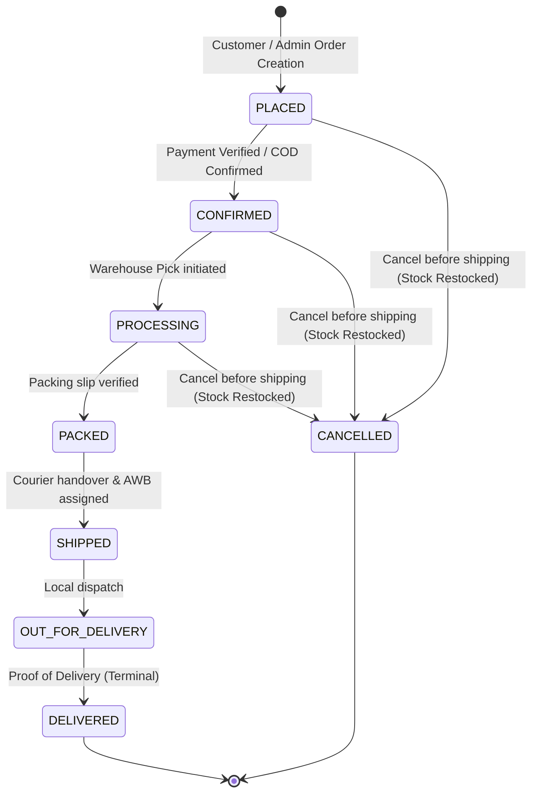
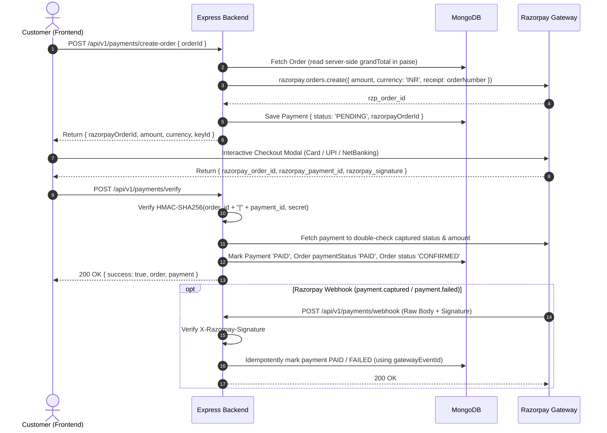
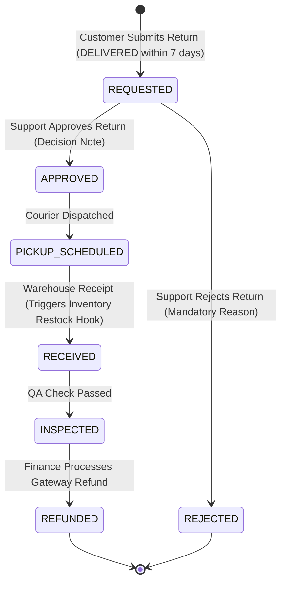

# E-Commerce CRM Backend — Orders, Payments, Returns & Refunds

Production-ready, highly secure modular monolith backend for the **Orders, Payments, and Returns/Refunds** subsystem of an enterprise MERN E-Commerce CRM.

---

## 1. High-Level Architecture & Principles

- **Modular Monolith**: One clean Express.js application organized into decoupled domain modules (`orders`, `payments`, `returns`, `refunds`, `audit`).
- **Strict Integer-Paise Arithmetic**: Floating-point representations are strictly forbidden for money. All amounts (subtotals, discounts, taxes, grand totals, payments, and refunds) are represented as non-negative **integer paise** (e.g., ₹799.00 = `79900` paise).
- **Hardening & Security**:
  - `helmet` security headers.
  - Narrow CORS policy with environment-configurable origins.
  - `express-mongo-sanitize` defending against NoSQL injection.
  - `express-rate-limit` defending against brute-force / DDoS attacks.
  - Append-only event histories (`statusHistory`, `events`, `history`).
  - Soft-deletions (`isArchived: true`), never destructive hard deletes.
  - MongoDB multi-document transactions where supported; atomic atomic updates as resilient fallback.
- **Razorpay Payment Gateway (Test Mode)**:
  - Encapsulated strictly behind an adapter interface (`src/integrations/payment/razorpay.adapter.js`).
  - Webhooks verified using HMAC-SHA256 on raw incoming byte streams before JSON body parsers.
  - Idempotent webhook handling tracking `gatewayEventId`.
- **Cloudinary Evidence Management**:
  - Direct multipart stream upload or Cloudinary URL storage for return inspection evidence.
  - Graceful fallback mock URL generator when API credentials are unset in local test environments.

---

## 2. System State Machines & Workflows

### A. Order Lifecycle State Machine


### B. Payment Flow (Razorpay Gateway)


### C. Return & Refund Lifecycle


---

## 3. Directory Structure

```
backend/
├── .env.example
├── package.json
├── README.md
├── postman/
│   ├── ecommerce-crm-phase1.postman_collection.json
│   ├── ecommerce-crm-phase2.postman_collection.json
│   └── ecommerce-crm-complete.postman_collection.json
├── src/
│   ├── app.js                           # Express application setup, middlewares, swagger
│   ├── server.js                        # HTTP server bootstrapping & graceful shutdown
│   ├── config/
│   │   ├── db.js                        # Mongoose connection & connection retry
│   │   ├── env.js                       # Environment validation via Zod
│   │   └── swagger.js                   # OpenAPI / Swagger configuration
│   ├── integrations/
│   │   ├── payment/
│   │   │   └── razorpay.adapter.js      # Gateway adapter (orders, signatures, webhooks, refunds)
│   │   ├── upload/
│   │   │   └── cloudinary.adapter.js    # Cloudinary image/document upload adapter with mock fallback
│   │   └── stubs/
│   │       ├── customerStub.js          # Customer service adapter stub
│   │       ├── productStub.js           # Product catalog adapter stub
│   │       ├── inventoryStub.js         # Inventory check & stock/restock adapter stub
│   │       ├── notificationStub.js     # Email, SMS & Push notification dispatch stub
│   │       └── eventBus.js              # Domain event publisher (order, payment, return, refund)
│   ├── middleware/
│   │   ├── auth.middleware.js           # JWT authentication & dev mock token generator
│   │   ├── permission.middleware.js     # RBAC granular permission check
│   │   ├── validate.middleware.js       # Zod schema request validation
│   │   ├── upload.middleware.js         # Multer multipart memory parser + Cloudinary pipe
│   │   └── error.middleware.js          # Centralized error envelope & status mapper
│   ├── modules/
│   │   ├── audit/
│   │   │   ├── auditLog.model.js
│   │   │   └── auditLog.service.js
│   │   ├── orders/
│   │   │   ├── order.model.js
│   │   │   ├── orders.controller.js
│   │   │   ├── orders.permissions.js
│   │   │   ├── orders.routes.js
│   │   │   ├── orders.service.js
│   │   │   └── orders.validation.js
│   │   ├── payments/
│   │   │   ├── payment.model.js
│   │   │   ├── payments.controller.js
│   │   │   ├── payments.permissions.js
│   │   │   ├── payments.routes.js
│   │   │   ├── payments.service.js
│   │   │   ├── payments.validation.js
│   │   │   └── refund.model.js
│   │   ├── refunds/
│   │   │   ├── refunds.controller.js
│   │   │   ├── refunds.routes.js
│   │   │   ├── refunds.service.js
│   │   │   └── refunds.validation.js
│   │   └── returns/
│   │       ├── return.model.js
│   │       ├── returns.controller.js
│   │       ├── returns.permissions.js
│   │       ├── returns.routes.js
│   │       ├── returns.service.js
│   │       └── returns.validation.js
│   └── utils/
│       ├── AppError.js                  # Custom operational HTTP error
│       ├── apiResponse.js               # Standardized response envelopes
│       ├── money.js                     # Integer-paise calculations & currency formatting
│       ├── orderNumber.js               # Cryptographic collision-resistant ID generators
│       ├── orderStateMachine.js         # Order state transitions & validations
│       └── returnStateMachine.js        # Return state transitions & validations
└── tests/
    ├── setup.js                         # In-memory MongoDB lifecycle for Jest
    ├── orders.test.js                   # Phase 1 unit & integration tests
    ├── payments.test.js                 # Phase 2 Razorpay unit & integration tests
    └── returns_refunds.test.js          # Phase 3 Returns & Refunds test suite
```

---

## 4. Setup & Running

### Requirements
- Node.js `v18+`
- MongoDB `v6.0+` (or Mongo Atlas URI)
- Razorpay Test Account (`rzp_test_...`)
- Cloudinary Account (optional; mock generator activates automatically when unset)

### Installation
```bash
# Clone and navigate to backend directory
cd backend

# Install dependencies
npm install

# Copy environment template
cp .env.example .env
```

### Environment Configuration (`.env`)
```ini
NODE_ENV=development
PORT=5000
API_PREFIX=/api/v1
MONGODB_URI=mongodb://localhost:27017/ecommerce-crm
JWT_SECRET=supersecretdevjwtkey_change_in_production_min32chars
JWT_EXPIRES_IN=7d
CORS_ORIGIN=http://localhost:3000,http://localhost:5173

# Razorpay Test Mode Keys
RAZORPAY_KEY_ID=rzp_test_mockKeyId123456
RAZORPAY_KEY_SECRET=mockKeySecretValueForTesting
RAZORPAY_WEBHOOK_SECRET=mockWebhookSecretForTesting

# Return Window Policy
RETURN_WINDOW_DAYS=7

# Cloudinary Storage (Optional - falls back to mock URL in test)
CLOUDINARY_CLOUD_NAME=demo
CLOUDINARY_API_KEY=mock_api_key
CLOUDINARY_API_SECRET=mock_api_secret
```

### Running the Application
```bash
# Start in development mode with auto-reload (nodemon)
npm run dev

# Start in production mode
npm start

# Run comprehensive test suite
npm test

# Run tests with code coverage report
npm run test:coverage
```

### Swagger Documentation
Once the server is running, navigate to:
- **Interactive Swagger UI**: `http://localhost:5000/api-docs`
- **OpenAPI 3.0.3 JSON Specification**: `http://localhost:5000/api-docs.json`

---

## 5. API Reference & Contract

| Module | Method | Endpoint | Permission | Description |
|---|---|---|---|---|
| **Orders** | `POST` | `/api/v1/orders` | `orders.create` | Create order with server-side paise calculations |
| **Orders** | `GET` | `/api/v1/orders` | `orders.read` | Paginated, filtered, and searched order listing |
| **Orders** | `GET` | `/api/v1/orders/:id` | `orders.read` | Retrieve single order by MongoDB ID or orderNumber |
| **Orders** | `PATCH` | `/api/v1/orders/:id/status` | `orders.update_status` | Advance order along strict state machine |
| **Orders** | `POST` | `/api/v1/orders/:id/cancel` | `orders.cancel` | Cancel order prior to `SHIPPED` & trigger restock |
| **Orders** | `GET` | `/api/v1/orders/:id/invoice` | `orders.read` | Structured JSON invoice with rupee & paise totals |
| **Orders** | `GET` | `/api/v1/orders/:id/tracking` | `orders.read` | Carrier milestones & tracking status |
| **Orders** | `GET` | `/api/v1/orders/:id/payment` | `orders.read` | Payment transactions linked to order |
| **Payments** | `POST` | `/api/v1/payments/create-order` | `payments.create` | Init Razorpay order with server grandTotal |
| **Payments** | `POST` | `/api/v1/payments/verify` | `payments.create` | Verify HMAC-SHA256 signature, mark PAID, CONFIRM order |
| **Payments** | `POST` | `/api/v1/payments/webhook` | *(Public + HMAC)* | Idempotent raw-body Razorpay webhook listener |
| **Payments** | `POST` | `/api/v1/payments` | `payments.create` | Record offline/manual payment (COD, Bank Wire) |
| **Payments** | `GET` | `/api/v1/payments` | `payments.read` | List payment transactions with pagination |
| **Payments** | `GET` | `/api/v1/payments/:id` | `payments.read` | Retrieve payment by ID |
| **Payments** | `PATCH` | `/api/v1/payments/:id/status` | `payments.create` | Manual payment status override with audit logging |
| **Payments** | `POST` | `/api/v1/payments/reconcile` | `payments.create` | Reconcile aged PENDING payments with gateway |
| **Returns** | `POST` | `/api/v1/returns` | `returns.create` | Submit return (multipart or JSON; validates 7d window) |
| **Returns** | `GET` | `/api/v1/returns` | `returns.read` | List return requests with status/order filtering |
| **Returns** | `GET` | `/api/v1/returns/:id` | `returns.read` | Retrieve return details by ID or returnNumber |
| **Returns** | `PATCH` | `/api/v1/returns/:id/approve` | `returns.approve` | Approve return with mandatory decision note |
| **Returns** | `PATCH` | `/api/v1/returns/:id/reject` | `returns.approve` | Reject return with mandatory reason note |
| **Returns** | `PATCH` | `/api/v1/returns/:id/status` | `returns.approve` | Advance return status (`PICKUP_SCHEDULED` -> `RECEIVED` -> `INSPECTED`) |
| **Refunds** | `POST` | `/api/v1/refunds` | `refunds.approve` | Create pending refund for inspected return / cancelled order |
| **Refunds** | `PATCH` | `/api/v1/refunds/:id/process` | `refunds.approve` | Disburse refund via Razorpay, update order `paymentStatus` |
| **Refunds** | `GET` | `/api/v1/refunds` | `payments.read` | List refund records |
| **Refunds** | `GET` | `/api/v1/refunds/:id` | `payments.read` | Retrieve refund by ID |
| **System** | `GET` | `/health` | *(Public)* | Service health status check |
| **System** | `GET` | `/api-docs.json` | *(Public)* | OpenAPI 3.0.3 specification JSON |

---

## 6. RBAC Permission Matrix

| Role | Permitted Actions |
|---|---|
| `admin` | Full permissions across Orders, Payments, Returns, and Refunds |
| `manager` | Full permissions across Orders, Payments, Returns, and Refunds |
| `support_agent` | `orders.read`, `orders.update_status`, `returns.read`, `returns.create`, `returns.approve` *(Cannot disburse refunds)* |
| `finance_agent` | `orders.read`, `payments.read`, `payments.create`, `refunds.approve` *(Cannot approve returns)* |
| `customer` | `orders.read`, `orders.create`, `payments.create`, `returns.read`, `returns.create` |
| `viewer` | `orders.read`, `payments.read`, `returns.read` |

---

## 7. Mongoose Database Schemas

### 1. `Order`
- `orderNumber`: String (unique, indexed, e.g. `ORD-20261112-XXXXXX`)
- `customer`: `{ customerId, name, email, phone }`
- `items`: `[ { product, name, sku, qty, unitPrice, discount, tax } ]` (all in integer paise)
- `subtotal`, `discountTotal`, `taxTotal`, `shippingFee`, `grandTotal`: Number (integer paise)
- `currency`: String (`'INR'`)
- `shippingAddress`, `billingAddress`: Structured Address Schema
- `status`: Enum (`PLACED`, `CONFIRMED`, `PROCESSING`, `PACKED`, `SHIPPED`, `OUT_FOR_DELIVERY`, `DELIVERED`, `CANCELLED`)
- `paymentStatus`: Enum (`PENDING`, `PAID`, `FAILED`, `PARTIALLY_REFUNDED`, `REFUNDED`)
- `paymentMethod`: Enum (`RAZORPAY`, `COD`, `BANK_TRANSFER`, `STRIPE`, `MANUAL`)
- `statusHistory`: Append-only array `[ { from, to, by: { userId, name, role }, at, note } ]`
- `isArchived`: Boolean (`index: true`)

### 2. `Payment`
- `order`: ObjectId -> `Order` (`index: true`)
- `amount`: Number (integer paise)
- `currency`: String (`'INR'`)
- `method`: Enum (`RAZORPAY`, `COD`, `BANK_TRANSFER`, `STRIPE`, `MANUAL`)
- `status`: Enum (`PENDING`, `PAID`, `FAILED`, `REFUNDED`, `PARTIALLY_REFUNDED`)
- `razorpayOrderId`, `razorpayPaymentId`, `razorpaySignature`: String
- `paidAt`: Date
- `events`: Append-only array `[ { event, payload, receivedAt } ]`
- `processedWebhooks`: Array of strings (`gatewayEventId`, unique indexed)

### 3. `Return`
- `returnNumber`: String (unique, indexed, e.g. `RET-20261112-XXXXXX`)
- `order`: ObjectId -> `Order` (`index: true`)
- `items`: `[ { product, qty, reason } ]`
- `reason`: String
- `evidence`: Array of Cloudinary URLs
- `refundAmount`: Number (calculated integer paise snapshot)
- `status`: Enum (`REQUESTED`, `APPROVED`, `REJECTED`, `PICKUP_SCHEDULED`, `RECEIVED`, `INSPECTED`, `REFUNDED`)
- `decisionBy`: `{ userId, name, role }`
- `decisionNote`: String
- `restocked`: Boolean
- `history`: Append-only array `[ { from, to, by: { userId, name, role }, at, note } ]`
- `isArchived`: Boolean (`index: true`)

### 4. `Refund`
- `refundNumber`: String (unique, indexed, e.g. `REF-20261112-XXXXXX`)
- `order`: ObjectId -> `Order` (`index: true`)
- `return`: ObjectId -> `Return` (optional, `index: true`)
- `payment`: ObjectId -> `Payment` (`index: true`)
- `amount`: Number (integer paise, validated against refundable balance)
- `currency`: String (`'INR'`)
- `status`: Enum (`PENDING`, `PROCESSED`, `FAILED`)
- `razorpayRefundId`: String
- `approvedBy`: `{ userId, name, role }`
- `processedAt`: Date
- `notes`: String
- `isArchived`: Boolean (`index: true`)

### 5. `AuditLog`
- `entity`: Enum (`Order`, `Payment`, `Return`, `Refund`)
- `entityId`: ObjectId / String (`index: true`)
- `action`: String (e.g. `RETURN_APPROVED`, `REFUND_PROCESSED`)
- `performedBy`: `{ userId, name, role }`
- `previousState`, `newState`: Object snapshots
- `metadata`: Object
- `timestamp`: Date (`default: Date.now`, `index: true`)
